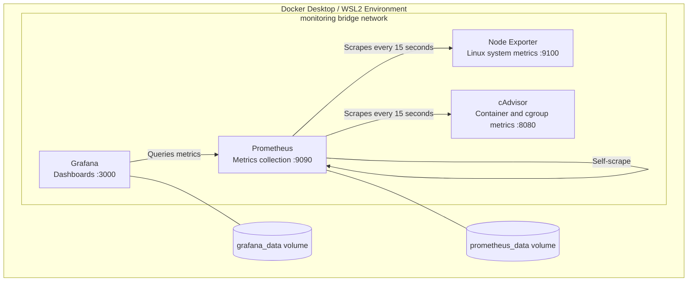

# Infrastructure Observability Lab

A local infrastructure monitoring lab built with Docker Compose, Prometheus, Grafana, Node Exporter, and cAdvisor. The project demonstrates container orchestration, metrics collection, dashboard provisioning, service validation, and infrastructure troubleshooting.

## Architecture



Prometheus scrapes its own metrics and the metrics exposed by Node Exporter and cAdvisor. Grafana queries Prometheus to display the collected time-series data. Docker Compose provisions the services on a shared bridge network.

**Environment note:** This lab currently runs through Docker Desktop with WSL2. Linux metrics exposed by this environment are not equivalent to native Windows performance counters.

## Technology Stack

| Technology | Purpose |
|---|---|
| Docker Compose | Service orchestration and networking |
| Prometheus | Metrics collection and storage |
| Grafana | Dashboards and visualization |
| Node Exporter | Linux system metrics |
| cAdvisor | Container and cgroup metrics |
| PowerShell | Deployment and validation |
| YAML / JSON | Service, scrape, and dashboard configuration |

## Prerequisites

- Windows with Docker Desktop installed and running, using the WSL2 backend.
- Git for cloning the repository.
- PowerShell.
- Available local TCP ports `3000` and `9090`.
- Internet access on first startup to pull the configured container images.

The web interfaces are bound to `127.0.0.1`, making them accessible locally rather than publishing them on every host network interface.

## Repository Structure

```text
infra-observability-lab/
├── docs/
├── grafana/
│   ├── dashboards/
│   │   └── infrastructure-overview.json
│   └── provisioning/
│       ├── dashboards/
│       │   └── dashboard-provider.yml
│       └── datasources/
│           └── prometheus.yml
├── prometheus/
│   └── prometheus.yml
├── .env.example
├── .gitignore
├── docker-compose.yml
└── README.md
```

## Setup

### 1. Clone the repository

Replace the placeholder URL with your actual GitHub repository URL.

```powershell
git clone <YOUR-GITHUB-REPOSITORY-URL>
cd infra-observability-lab
```

Alternatively, if you already have the repository locally, open PowerShell in its root directory.

### 2. Configure Grafana credentials

Copy the example environment file:

```powershell
Copy-Item .env.example .env
```

Edit `.env` and replace the example password with a strong, unique password:

```text
GRAFANA_ADMIN_PASSWORD=replace-with-a-strong-unique-password
```

Do not commit `.env` or publish real credentials. The `.env.example` file contains only a placeholder.

### 3. Start the stack

```powershell
docker compose up -d
```

### 4. Check service status

```powershell
docker compose ps
```

Confirm that the four services are running. Startup status alone does not prove that all metrics are being collected correctly.

### 5. Open the interfaces

- Grafana: http://localhost:3000
- Prometheus: http://localhost:9090

Sign in to Grafana with username `admin` and the password configured in `.env`. The provisioned Prometheus data source and dashboard should load from the configuration files.

## Validation

### Check Prometheus scrape targets

Run this PowerShell command:

```powershell
(Invoke-RestMethod "http://localhost:9090/api/v1/targets").data.activeTargets |
    Select-Object @{Name="Job";Expression={$_.labels.job}},
                  @{Name="Health";Expression={$_.health}},
                  @{Name="LastError";Expression={$_.lastError}}
```

The expected jobs are `prometheus`, `node_exporter`, and `cadvisor`. A healthy target should report `up`. Investigate `LastError` if a target is down.

### Inspect available metrics

Open the Prometheus interface and try these example queries:

```promql
up
```

```promql
node_cpu_seconds_total
```

```promql
container_memory_working_set_bytes
```

These queries help verify that metrics exist. Their presence alone does not establish that they represent native Windows resources or that every series corresponds to an individual Docker container.

## Current Implementation

- Four services defined in Docker Compose.
- A shared bridge network for monitoring traffic.
- Prometheus configured with a 15-second scrape and evaluation interval.
- Grafana data source and dashboard provisioning from version-controlled configuration.
- Persistent named volumes for Prometheus and Grafana data.
- Local-only port bindings for the Grafana and Prometheus interfaces.
- Dashboard panels for CPU and memory metrics.
- Prometheus target health validated through its HTTP API.

## Known Limitations

- **Native Windows metrics:** Windows Exporter has not yet been integrated. The lab does not currently provide validated Windows-native CPU, memory, disk, and network performance metrics.
- **Metric attribution:** The inspected cAdvisor series use cgroup identifiers. Queries and labels still need to be validated to ensure resource usage can be attributed reliably to individual containers.
- **Linux environment visibility:** Node Exporter runs in a container and is configured with `--path.rootfs=/host`. Its exposed metrics must be interpreted in the context of the Linux environment and namespaces visible to it, not assumed to represent all Windows host resources.
- **Workload testing:** A dedicated Nginx workload has not yet been added to generate repeatable application traffic.
- **Alerting:** Alert rules and notification delivery have not yet been implemented.

## Troubleshooting Notes

Issues investigated during development include:

- Correcting a UTF-8 byte-order-mark issue that prevented Grafana from parsing dashboard JSON.
- Inspecting Prometheus metric labels and revising queries to use labels available in the returned series.
- Checking Docker Compose service status and Prometheus target health.
- Distinguishing successful metric collection from correct metric attribution.

## Planned Improvements

1. Integrate Windows Exporter to collect native Windows performance metrics.
2. Add an Nginx workload to generate controlled application traffic.
3. Validate container-level CPU and memory attribution and refine PromQL queries.
4. Add alert rules for selected resource thresholds.
5. Add screenshots and a troubleshooting runbook under `docs/`.

## Skills Demonstrated

Docker Compose, Prometheus, Grafana, Linux observability, metrics and PromQL, YAML/JSON configuration, PowerShell, service validation, troubleshooting, and technical documentation.
